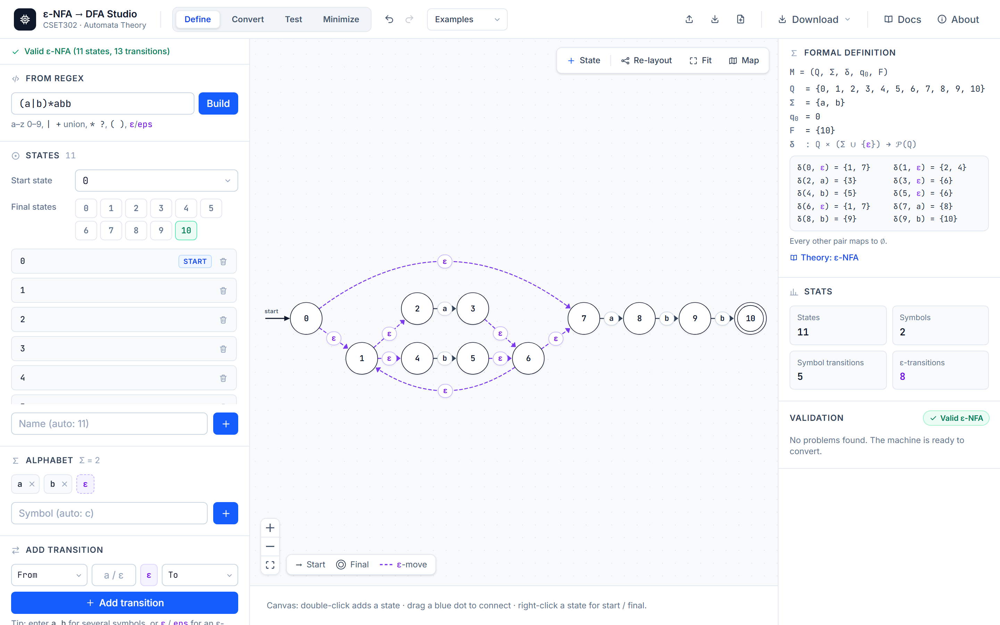
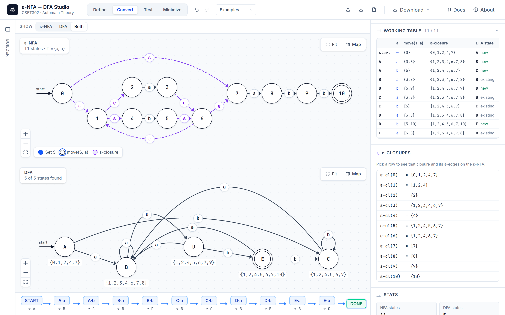
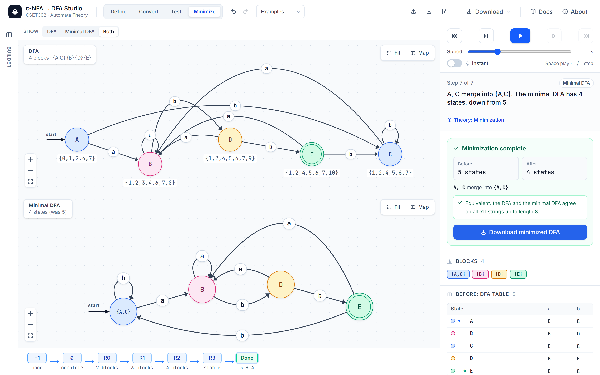

# ε-NFA → DFA Simulator

An interactive web tool that converts an ε-NFA into an equivalent DFA, shows every step of the conversion, tests strings on both machines and minimises the result.

Course: CSET302 Automata Theory and Computability, Bennett University · Guide: Dr. Sunil Kumar

**Live demo:** https://shaauryaa.github.io/epsilon-nfa-to-dfa-simulator/


## Overview

The app has four modes, one per tab:

| Mode | What it does |
| --- | --- |
| **Define** | Build an ε-NFA: type a regular expression, use the builder (states, alphabet, transitions), edit the text format, draw on the canvas, load an example or import a file. The machine is validated live. |
| **Convert** | Subset construction, step by step. Each step animates on the ε-NFA (set T, move(T, a), the ε-closure spreading) while the DFA grows next to it. Side panel: DFA table, working table, ε-closures, stats. |
| **Test** | Run a string on the ε-NFA and the DFA at the same time, symbol by symbol, with traces; batch-test many strings with expected results; check equivalence on all strings up to a length. |
| **Minimize** | Moore partition refinement, round by round, with the split that happens in each round, then the minimal DFA next to the original. |

Every DFA (converted or minimised) downloads as JFLAP `.jff`, JSON, text, Graphviz `.dot`, CSV, PNG, SVG, Python or JavaScript code. A full PDF report covers the input, ε-closures, the working table, the DFA, minimisation and test results.

## Features

- **From regex:** type `(a|b)*abb` and get its Thompson ε-NFA (states numbered in construction order).
- Builder with live validation (undeclared states, symbols outside Σ, unreachable states), undo / redo, and a text format.
- Nine example machines, including the textbook (a|b)*abb machine, an ε-cycle, a dead-state case, the 2ⁿ blow-up and multi-character symbols.
- Import `.json`, `.jff` (JFLAP) and `.txt` files; export the ε-NFA as JSON.
- Animated subset construction with a player (step, play, speed, skip), a bottom step timeline and a dead-state ∅ toggle.
- Working table: T | symbol | move(T, a) | ε-closure | DFA state (new or existing), one row per step.
- Test tab: input tape, both machines in step, ε for the empty string, invalid symbols reported as "symbol n is not in Σ" (not as a rejection), batch tester with PASS / FAIL / INVALID and CSV, equivalence check.
- Minimisation walkthrough with coloured blocks, the witness symbol for each split and a shortest distinguishing string.
- Docs dialog with theory cards (ε-NFA, Thompson, ε-closure, move, subset construction, dead state, minimisation, complexity), "How to use" and keyboard shortcuts.
- Large machines stay usable: DFAs with more than 60 states are shown as tables only.

### Plain NFAs and DFAs also work

An NFA without ε-moves and a DFA are special cases of an ε-NFA, so they can be entered the same way. Subset construction on an NFA works as usual (ε-closures are single states); on a DFA it gives the same machine with renamed states. The "Plain NFA: ends in 01" example shows this. The text format:

```text
states: q0 q1 q2
alphabet: 0 1
start: q0
final: q2
q0 0 -> q0 q1
q0 1 -> q0
q1 1 -> q2
```

Use `eps` (or `ε`) as the symbol for an ε-move: `q0 eps -> q1`.

## Quick start

Requires Node.js 20 or newer (CI uses Node 24).

```sh
git clone https://github.com/shaauryaa/epsilon-nfa-to-dfa-simulator.git
cd epsilon-nfa-to-dfa-simulator/SourceCode
npm ci
npm run dev           # dev server; open the URL it prints
```

Other scripts, all run from `SourceCode/`:

| Command | What it does |
| --- | --- |
| `npm test` | Unit and property tests (Vitest) |
| `npm run e2e` | Builds, then runs the browser tests (Playwright, headless Chromium) |
| `npm run test:report` | Runs every test case in `TestCases/` and writes `results.csv` and `results.md` |
| `npm run build` | Type-checks and builds the production site into `dist/` |
| `npm run preview` | Serves the production build locally |
| `npm run screenshots` | Builds, then saves the report figures into `../Screenshots` (1440×900 at 2×) |
| `npm run lint` / `npm run typecheck` | oxlint and strict TypeScript |

The first `npm run e2e` on a new machine needs the browser: `npx playwright install chromium`.

## Project structure

```
SourceCode/             Vite + React + TypeScript app
  src/core/             Pure algorithms, no React or DOM: types, validation and text format,
                        ε-closure and move, subset construction, minimisation, simulation,
                        equivalence, regex parser + Thompson, import and export
  src/model/            UI-independent view logic: animation plans, layouts, test runs,
                        minimisation view, SVG drawing, report sentences
  src/store/            Zustand stores: the machine and its derived results, undo history,
                        players for Convert / Test / Minimize, toasts, docs
  src/components/       React UI: builder, canvas, convert, test, minimize, dialogs
  src/graph/            dagre layout and edge routing
  src/lib/              PDF report, downloads, crash recovery
  src/presets/          Example machines with expected results
  tests/                Vitest unit and property tests
  e2e/                  Playwright browser tests and the screenshot script
  scripts/              Test-report generator
TestCases/              Example machines as JSON, and the generated results.csv / results.md
Screenshots/            Figures for the report and this README
Report/                 Project report
docs/                   Architecture, demo script, viva questions
.github/workflows/      CI: lint, test, test report, e2e, build, deploy to GitHub Pages
```

More detail: [docs/architecture.md](docs/architecture.md).

## Algorithms

| Algorithm | Where | Complexity |
| --- | --- | --- |
| ε-closure | `core/closure.ts` | Depth-first search over ε-edges: O(V + E) for V states and E ε-transitions. |
| move(T, a) | `core/closure.ts` | O(Σ over q in T of \|δ(q, a)\|). |
| Subset construction | `core/subset.ts` | Builds only reachable subsets. Worst case 2ⁿ DFA states for n NFA states, so O(2ⁿ · \|Σ\| · n²) time. Stops with an error past 4096 DFA states. |
| Minimisation | `core/minimize.ts` | Moore's partition refinement: remove unreachable states, add the dead state if needed, split {F, Q − F} until stable. O(n² · \|Σ\|). |
| Regex → ε-NFA | `core/regex.ts` | Recursive-descent parser, then Thompson's construction: one fragment per operator, at most 2 new states each, so O(m) states and transitions for a regex of length m. |
| Simulation | `core/simulate.ts` | ε-NFA: one closure per symbol, O(\|w\| · (V + E)); DFA: O(\|w\|). |

**Why the minimal DFA is correct.** Two states are merged only if no string tells them apart. Round k separates states that some string of length ≤ k distinguishes; when a round splits nothing, no longer string can either, so the blocks are exactly the Myhill–Nerode classes and the minimal DFA is unique up to renaming.

## Worked example: (a|b)*abb

Typing `(a|b)*abb` into **From regex** builds the Thompson ε-NFA with states 0–10 (start 0, final 10), the same machine as in Aho, Lam, Sethi and Ullman, Fig. 3.34.



Subset construction finds five DFA states:

| DFA state | NFA states | on a | on b |
| --- | --- | --- | --- |
| → A | {0,1,2,4,7} | B | C |
| B | {1,2,3,4,6,7,8} | B | D |
| C | {1,2,4,5,6,7} | B | C |
| D | {1,2,4,5,6,7,9} | B | E |
| \* E | {1,2,4,5,6,7,10} | B | C |

For example, A = ε-closure({0}); move(A, a) = {3, 8} and ε-closure({3, 8}) = B.



Minimisation: round 0 splits {E} | {A,B,C,D}; round 1 splits off D (on b it goes to E); round 2 splits off B (on b it goes to D); round 3 is stable. A and C behave the same on every string, so the minimal DFA has 4 states: **{A,C}, B, D, E**.



## Testing

| Suite | Count | Command |
| --- | --- | --- |
| Unit and property tests (Vitest) | 507 tests in 27 files | `npm test` |
| Browser tests (Playwright) | 30 tests | `npm run e2e` |
| Test report (`TestCases/results.md`) | 372 cases, all PASS | `npm run test:report` |

- **Unit tests** cover validation, the text format, ε-closure (including ε-cycles), subset construction against textbook tables, the dead state, minimisation, simulation, import and export (JFLAP round trip), the regex parser (precedence, associativity, 1-based error positions) and Thompson's construction.
- **Property tests:** 500 random ε-NFAs, where the ε-NFA, DFA, partial DFA and minimal DFA must agree on all 127 strings over {a, b} up to length 6; and 150 random regexes, where the Thompson ε-NFA must agree with JavaScript's `RegExp` on the same strings.
- **Browser tests** run the production build: every example converts to the expected number of states, the A–E table, the dead-state toggle, From regex → Convert → Minimize, Test accept / reject / invalid input, batch tester, equivalence, downloads and re-import, layout at 1366×768, and worst cases (4096-state DFA, 5,003-symbol input, junk files). Any console error fails a test.
- **Test report:** for each example, the expected DFA size, textbook table, minimal size, accept and reject strings on all three machines, invalid symbols, plus validation cases.

CI (GitHub Actions) runs lint, unit tests, the test report, the browser tests and the build on every push to `main`, then deploys to GitHub Pages.

## Known limitations

- **Multi-character symbols** are read with a greedy (longest match first) tokenizer that does not backtrack: with Σ = {a, ab, bc} the input `abc` is rejected as invalid even though `a bc` would work. Separate symbols with spaces to avoid this.
- **Large DFAs:** above 60 DFA states the diagram and animation are hidden and the DFA is shown as a paged table.
- **Construction cap:** subset construction stops past 4096 DFA states (for example, a 13-state "k-th symbol from the end" machine) to keep the browser responsive.
- **Regex syntax** allows single-character symbols a–z and 0–9 only; `eps` always means ε, so it cannot be read as e·p·s.
- JFLAP files keep their state positions in the parsed data, but imported machines are laid out automatically.
- If the deployed page is blank, check that the Vite `base` path matches the repository name.

## Team and contributions

| Name | Enrollment No. | Contributions |
| --- | --- | --- |
| Shaurya Nigam | S24CSEU0497 | TODO: list Shaurya's contributions |
| Vishnu Verma | S24CSEU2382 | TODO: list Vishnu's contributions |

Guide: **Dr. Sunil Kumar**, Bennett University.

## References

1. A. V. Aho, M. S. Lam, R. Sethi, J. D. Ullman. *Compilers: Principles, Techniques, and Tools*, 2nd ed. Chapter 3 (Thompson's construction, subset construction, DFA minimisation).
2. J. E. Hopcroft, R. Motwani, J. D. Ullman. *Introduction to Automata Theory, Languages, and Computation*, 3rd ed. (ε-NFAs, equivalence of NFAs and DFAs, Myhill–Nerode and minimisation).

## Credits

Libraries: [React](https://react.dev), [TypeScript](https://www.typescriptlang.org), [Vite](https://vite.dev), [Tailwind CSS](https://tailwindcss.com), [React Flow](https://reactflow.dev), [dagre](https://github.com/dagrejs/dagre), [Zustand](https://github.com/pmndrs/zustand), [jsPDF](https://github.com/parallax/jsPDF) and jspdf-autotable, Inter and JetBrains Mono (Fontsource), DejaVu fonts (PDF), [Vitest](https://vitest.dev), [Playwright](https://playwright.dev), [oxlint](https://oxc.rs).

UI inspiration: the layout (navbar mode switcher, left builder, centre canvas, right panel, bottom step timeline) follows a peer project, *automata-pro*; the step-by-step animation style follows David Galles' data-structure visualizations (University of San Francisco).

Licensed under the [MIT License](LICENSE).
